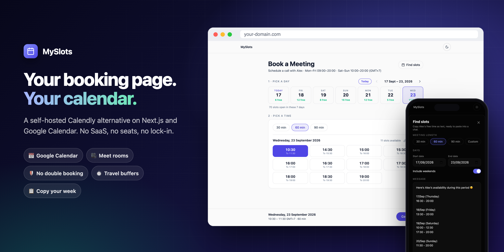
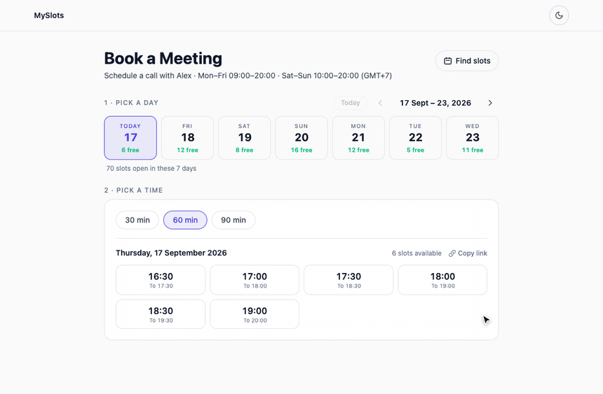
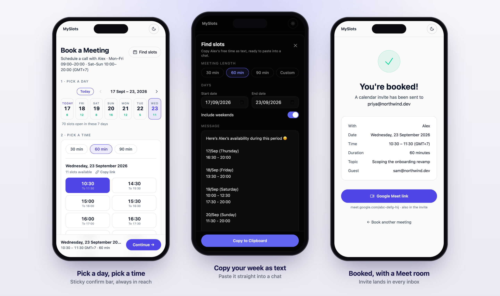
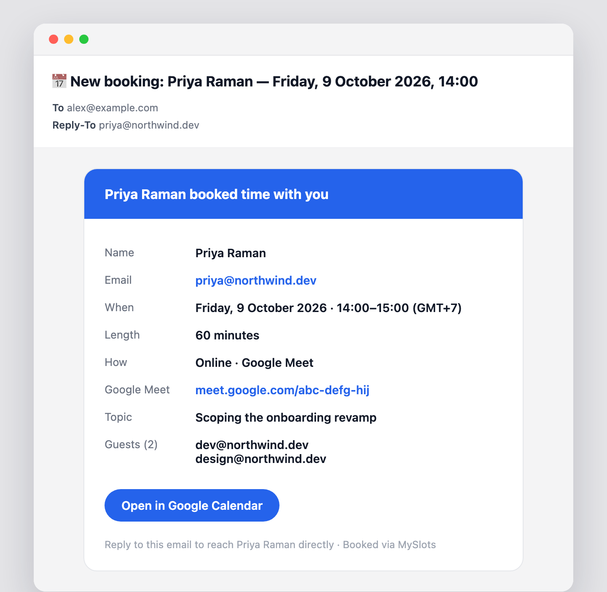
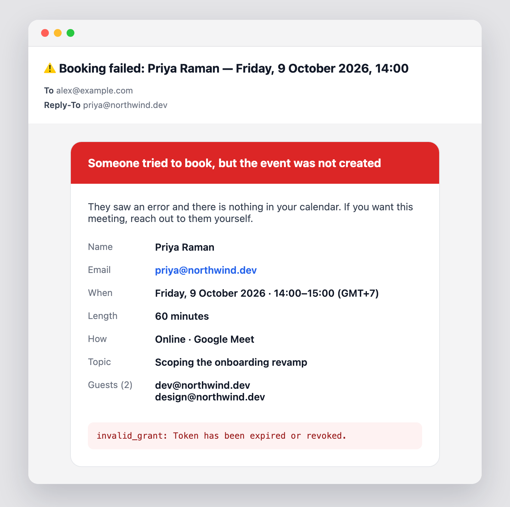

<div align="center">



# MySlots

**A self-hosted Calendly alternative for one person.**<br>
Visitors pick a day, pick a time, and land on your Google Calendar with a Meet room
and an invite in every inbox. No SaaS, no seats, no account for them to create.

[](LICENSE)
[](https://nextjs.org)
[](https://react.dev)
[](https://www.typescriptlang.org)
[](https://tailwindcss.com)
[](package.json)

**[▶ Try the live demo](https://myslots-demo.vercel.app)** — a synthetic calendar, so book away; nobody gets an invite.

[](https://vercel.com/new/clone?repository-url=https%3A%2F%2Fgithub.com%2Ftlejay%2Fmyslots&project-name=myslots&repository-name=myslots)

[Features](#-what-you-get) · [Meet in person](#meet-in-person) · [Quick start](#quick-start) · [Connect Google Calendar](#connect-your-google-calendar) · [How it works](#how-it-works) · [Deploy](#deploy)

</div>

---

## ✨ What you get

| Feature | What it does |
|---|---|
| 📅 **Real availability** | Reads your Google Calendar. Only *when* you are busy leaves the server — never titles or attendees |
| 🎥 **A Meet room on every online booking** | Created with the event, shown on the confirmation screen and in every invite |
| 📍 **Online or in person** | Visitors pick a city, see only the days you are there, and say where to meet. You say where you are with an `@ City` event on your own calendar |
| 🛡️ **No double booking, no back-to-back** | The calendar is re-checked the instant someone confirms, and a buffer keeps time clear around every event for travel or prep — after a 09:00–10:00 meeting the first slot is 10:30 |
| 📋 **Copy your week as text** | **Find slots** turns a date range into a paste-ready message for LINE, Slack or email |
| 📬 **The email Google won't send you** | Google never tells the calendar owner about their own events, so MySlots mails you through Gmail |
| 🔗 **Every view is a link** | `?date=…&duration=…&time=…` — send someone straight to a slot |
| 📱 **Phone-first** | Sticky confirm bar, 16px inputs (no iOS zoom), skeletons that hold the layout still |
| 🌗 **Light and dark** | Dark by default, one tap to light, and the choice is remembered |
| 🧪 **Demo mode** | `pnpm dev` with no credentials runs the whole flow against a synthetic calendar |

## 🎬 See it in action

<p align="center">
  
</p>

## 📱 Built for the phone

<p align="center">
  
</p>

<sub>More: [desktop](docs/screenshot.png) · [dark theme](docs/screenshot-dark.png) · [details form](docs/screenshot-form.png) · [confirmation](docs/screenshot-confirmed.png) · [Find slots](docs/screenshot-find-slots.png)</sub>

## 🤔 MySlots or a hosted scheduler?

| | MySlots | A hosted scheduler |
|---|---|---|
| **Price** | Free, MIT — you pay only for hosting (Vercel's free tier is plenty) | Free tier, then per seat |
| **Where your data lives** | Your Google account and your own deployment | Their servers |
| **Changing how it works** | Edit `config.ts`, or fork and change anything | Whatever their settings page offers |
| **Setup** | About 10 minutes in Google Cloud, once | Sign up |

If you want teams, round-robin or paid bookings, a hosted tool is the better fit.
If you are one person who wants a page that is *yours*, this is it.

---

## Why it looks like this

Most self-built booking pages render a week grid of unlabeled cells and leave you
to trace across from an hour column. This one answers the two questions people
actually arrive with, in order:

1. **Which days are open?** A strip of seven day cards, each showing how many
   slots are free. Days with nothing left are dimmed and unclickable. The strip
   starts at **today** — nobody books backwards — and a `Today` button brings you
   home after you page forward.
2. **What time?** Real buttons with the start time leading and the end time
   trailing underneath, smaller and quieter, so a screenful of options still has
   one thing to scan.

Once a time is chosen, the confirm bar sticks to the bottom of the viewport, and
the layout holds its height with skeletons while availability reloads — changing
the meeting length never makes the page jump under the cursor.

Every booking gets a **Google Meet** room on the invite, and the link is on the
confirmation screen too — no "I'll send a link" follow-up.

On the details form, **Add guest** reveals an email row on demand — nothing takes
up space until someone actually wants it — and every guest is added to the
calendar invite, so Google emails them all at once.

---

## The email Google will not send you

Google emails an invite to every attendee **except the account that created the
event** — and a self-hosted booking page creates events with your own
credentials. Every guide to building one of these stops there, which is why they
all share the same quiet failure: a stranger books you, and the first you hear
of it is a meeting sitting in your calendar that you never saw arrive.

So MySlots mails you itself, through the Gmail API, on the same OAuth consent it
already uses to read your calendar. No SMTP server, no transactional-email
vendor, no second account to keep alive.



Everything you need to decide whether to prepare is in the one card — who booked,
what they want to talk about, who else is coming — and `Reply-To` is set to the
booker, so answering them is one keystroke rather than a copy-paste.

**Failures get a letter too.** If the calendar write throws, the visitor sees an
error and walks away; without this, so does the meeting.



Sending is best-effort by design: a booking that reached your calendar is never
reported as failed because Gmail was unhappy. Problems are logged instead, and
the most common one — a refresh token minted before the `gmail.send` scope
existed — logs the exact fix.

> Both pictures are rendered from
> [`src/lib/booking-email-template.ts`](src/lib/booking-email-template.ts) by
> `pnpm mockup`, so the README cannot drift away from the mail that actually
> goes out.

---

## Links you can hand out

The picker keeps its whole state in the query string, so any view you are looking
at is a link you can send:

```
https://your-domain.com/?date=2026-10-09&duration=30&time=14:00
```

| Param | Meaning |
|---|---|
| `date` | `YYYY-MM-DD`. A day in the past or beyond `MAX_DAYS_AHEAD` falls back to the default view |
| `duration` | One of the meeting lengths in `config.ts` — 30, 60 or 90 by default |
| `time` | `HH:MM` in the host's zone. Opens with that slot already selected, if it is still free |

The address bar follows every day, length and slot you click, and a **Copy link**
button sits beside the slot count. Nothing is pre-generated: no routes, no
tokens, no stored links — just the state the page is already in. Updates go
through `history.replaceState`, so Back still returns visitors to wherever they
came from rather than walking them through every tile they tried.

---

## Send your free time as text

Sometimes a link is the wrong shape — the other person wants to see your week in
the chat, not open a page. **Find slots** (top right) writes it out
([screenshot](docs/screenshot-find-slots.png)):

```
Here’s Alex’s availability during this period 😊

23/Sep (Wednesday)
10:30 - 13:00

24/Sep (Thursday)
14:00 - 15:00

25/Sep (Friday)
No availability
—
Feel free to book a time that works for you here: your-domain.com
```

Pick a meeting length (30 / 60 / 90 or a custom number of minutes), a start and
an end date, and whether weekends count, then **Copy to Clipboard**. Free time
that touches is merged into one stretch, and stretches too short for the chosen
length are left out — so every line is a time the other person can really book.
The message re-renders instantly as you change the length or weekends; only a new
date range goes back to the calendar.

---

## Meet in person

The first choice on the page is **how to meet**: online (a Google Meet room, as
before) or **in person**. In person, the visitor picks a city from the list in
`config.ts`, sees only the days and hours you are there, and must say where to
meet — a café, an office address, a map link. That goes on the invite as the
event's location, and there is no Meet room.

**Telling it where you are.** There is no admin page and no database — you put
an event on your own calendar whose title starts with `@ `:

| Event on your calendar | What visitors see |
|---|---|
| *(nothing)* | You are in `DEFAULT_LOCATION` (Downtown in the sample config) |
| `@ Uptown`, all day | Uptown is open that day, Downtown is shut |
| `@ Uptown`, 13:00–24:00 | Downtown in the morning, Uptown from 13:00 |
| `@ Lisbon`, all day | Somewhere not in the list — in person is shut everywhere that day |
| `@ Downtown` 10:00–12:00 inside an all-day `@ Uptown` | A trip there and back: the later event wins for its stretch |

- Titles match a city's `id`, `label` or any of its `aliases`, ignoring case and
  extra spaces (`@ uptown`, `@  North side`). Multi-day all-day events work.
- These events are **never counted as busy**, whether you leave them as *Busy*
  or set them to *Free* — they say where you are, not what you are doing. Online
  booking is not affected by them at all.
- Set `DEFAULT_LOCATION = null` if you would rather nothing be bookable in
  person unless an `@ City` event says so.

**The journey.** An in-person meeting keeps 45 minutes clear on each side
(`ONSITE_BUFFER_BEFORE_MINUTES` / `…_AFTER_…`), and the whole stretch — journey
included — must fall inside your time in that city. With `@ Uptown` from 10:00,
the earliest in-person start is 10:45 (11:00 on the 30-minute grid). Buffers do
not stack: the gap between two things is the larger of the two buffers, so after
an in-person 14:00–15:00 the next meeting of either kind may start at 15:45.

When someone books in person, two `🚗 Travel` events go on your calendar either
side of the meeting (busy, private, no invitations), so other people's
schedulers see the journey too. MySlots itself ignores them — the meeting's own
buffer already stands for them. Each has a fixed id, so a retry after a lost
answer never makes a second copy; if one still fails, the notification email
says so with the times to block by hand.

Links carry the choice too — `?mode=onsite&city=uptown&date=…` opens straight
on Uptown — and **Find slots** follows whichever mode is selected. In demo mode
the synthetic calendar has an Uptown day, an Uptown afternoon and a day out of
town in every week, so the whole flow can be tried without credentials.

`pnpm check:booking` runs the rules — buffers, location events, request parsing,
travel retries — against the real modules, no server or calendar needed.

---

## Quick start

```bash
git clone https://github.com/tlejay/myslots.git
cd myslots
pnpm install
pnpm dev
```

Open <http://localhost:3000>. With no credentials configured the app runs in
**demo mode**: availability is synthesised deterministically, so you can click
through the entire flow — including the confirmation screen — before you touch
Google Cloud. Bookings made in demo mode are not written anywhere and no invite
is sent.

Then make it yours in [`src/lib/config.ts`](src/lib/config.ts):

```ts
export const HOST_NAME = 'Alex'          // "Alex is available weekdays 9am–8pm…"
export const BRAND_NAME = 'MySlots'      // nav label
export const DURATIONS = [30, 60, 90]    // meeting lengths offered
export const WEEKDAY_HOURS = { start: 9, end: 20 }
export const WEEKEND_HOURS = { start: 10, end: 20 }
export const DAILY_BREAK = { start: 12, end: 13 } // lunch; null keeps the day whole
export const ADD_GOOGLE_MEET = true     // a Meet room on every invite
export const BUFFER_BEFORE_MINUTES = 30 // kept clear before a booked meeting
export const BUFFER_AFTER_MINUTES = 30  // …and after it; 0 allows back-to-back
export const CITIES = [                 // where people can meet you in person
  { id: 'downtown', label: 'Downtown', aliases: ['city centre'] },
  { id: 'uptown', label: 'Uptown', aliases: ['north side'] },
]
export const DEFAULT_LOCATION = 'downtown' // where you are without an "@ City" event
```

---

## Connect your Google Calendar

You need three secrets: an OAuth **client ID**, a **client secret**, and a
**refresh token** for the account whose calendar you are booking. Roughly ten
minutes, once.

### 1. Create a Google Cloud project and enable the API

1. Open the [Google Cloud Console](https://console.cloud.google.com/) and create
   a project (or pick an existing one).
2. **APIs & Services → Library** → search for **Google Calendar API** → **Enable**.

### 2. Configure the OAuth consent screen

1. **APIs & Services → OAuth consent screen**.
2. User type **External** is fine even for a personal calendar.
3. Fill in the app name and your email. You do **not** need to submit for
   verification — while the app is in *Testing*, add your own Google account
   under **Test users** and it will work indefinitely for you.
4. Add two scopes:
   - `https://www.googleapis.com/auth/calendar` — read events, write bookings
   - `https://www.googleapis.com/auth/gmail.send` — mail you when someone books

> `gmail.send` is only used to send you the notification above. Skip it and
> everything else still works; the app just logs that it could not tell you.

> A *Testing* app issues refresh tokens that expire after 7 days. If you would
> rather not re-mint weekly, click **Publish app** on the consent screen. For an
> app that only ever authorises its own author, publishing needs no review.

### 3. Create OAuth credentials

1. **APIs & Services → Credentials → Create credentials → OAuth client ID**.
2. Application type: **Web application**.
3. Under **Authorised redirect URIs** add exactly:

   ```
   http://localhost:5789/oauth2callback
   ```

4. Copy the **Client ID** and **Client secret** into `.env.local`:

   ```bash
   cp .env.example .env.local
   ```

   ```ini
   GOOGLE_CLIENT_ID=1234567890-abcdefg.apps.googleusercontent.com
   GOOGLE_CLIENT_SECRET=GOCSPX-xxxxxxxxxxxxxxxx
   ```

### 4. Mint a refresh token

```bash
pnpm token
```

The script starts a one-shot server on port 5789 and prints a consent URL. Open
it, sign in as the calendar owner, approve, and the terminal prints:

```
GOOGLE_REFRESH_TOKEN=1//0gxxxxxxxxxxxxxxxxxxxxxxxx
```

Paste that into `.env.local`. Nothing is written to disk for you — the token
never leaves your terminal.

### 5. Point at a calendar

```ini
GOOGLE_CALENDAR_ID=you@example.com
```

Use the Google account's own address for its main calendar, or copy a secondary
calendar's ID from **Google Calendar → Settings → *calendar name* → Integrate
calendar → Calendar ID**. Leave it unset and the app falls back to `primary`.

Restart `pnpm dev`. The banner-free page now reads your real calendar.

---

## How it works

Three endpoints, all under `src/app/api/`. The working-hours and slot-grid rules
they share live in `src/lib/booking-time.ts`, so the page never offers a time the
server would refuse.

### `GET /api/availability?date=YYYY-MM-DD&duration=60`

Generates every candidate slot for that date from the configured working hours,
reads the day's events to see what is taken, and labels each slot. Add
`&mode=onsite&city=uptown` for in person.

```jsonc
{
  "slots": [
    { "start": "2026-09-01T02:00:00.000Z", "display": "09:00", "available": true,  "reason": "available" },
    { "start": "2026-09-01T02:30:00.000Z", "display": "09:30", "available": false, "reason": "busy" },
    { "start": "2026-09-01T03:00:00.000Z", "display": "10:00", "available": false, "reason": "past" }
  ],
  "demo": false
}
```

Only *when* you are busy goes out, never event titles or attendees — so this
endpoint cannot leak the contents of your calendar even though it is public.
Events are read rather than free/busy because free/busy cannot tell an
in-person booking from any other block, or leave out `@ City` and travel events.

In person, the response adds when you are in that city that day (`presence`,
local times) and, on a day you are not, which listed city you are in instead
(`hostCity`, `null` for anywhere else). Hours outside `presence` are treated as
busy, with the meeting's 45-minute journey kept clear of them.

```jsonc
{ "slots": [/* … */], "hostCity": "uptown", "presence": [{ "start": "13:00", "end": "24:00" }], "demo": false }
```

**Buffers.** Before any slot is checked, every busy block is grown by the buffers
in `config.ts`: its end moves later by `BUFFER_BEFORE_MINUTES`, its start earlier
by `BUFFER_AFTER_MINUTES`. With both at 30, a 09:00–10:00 event counts as busy
from 08:30 to 10:30, so the first slot after it is 10:30 — and a meeting may end
no later than 30 minutes before the next event. In-person meetings use 45 on
each side, and two buffers never add up — see [Meet in person](#meet-in-person). The widening happens once, in
`busyBetween` (`src/lib/google-calendar.ts`), so all three endpoints — and demo
mode — agree. It applies to every event on the calendar, not only bookings made
here, the same way Calendly's buffers do. Buffers may spill past working hours,
and they are never written to the calendar.

**The daily break.** `DAILY_BREAK` in `config.ts` carves an hour out of the
middle of every day — lunch, a school run, a nap. Working hours then come in two
pieces, and only what fits inside one of them is offered: with
`{ start: 12, end: 13 }`, 11:00–12:00 and 13:00–14:00 are bookable but
11:30–12:30 is not, and a 90-minute meeting starting at 11:00 is refused. It is
a *closed* stretch of the day, not a busy block, so unlike a calendar event it
grows no buffer around itself and eats nothing on either side. The Find slots
text reports it as a gap (`09:00 - 12:00` then `13:00 - 20:00`), and the hours
line under the heading is generated from the same ranges, so it cannot disagree
with what the picker offers. Leave it `null` and the day stays in one piece.

The client fetches all seven visible days in parallel and counts the
`available` slots per day to fill in the day strip. Weeks already seen are kept,
so paging back is instant.

### `GET /api/availability/windows?from=YYYY-MM-DD&to=YYYY-MM-DD`

One calendar read for the whole range, answered as free stretches per day —
what **Find slots** turns into text. Edges are snapped inward onto the slot grid
and anything already past is cut off. The range is clamped to today …
`MAX_DAYS_AHEAD`. Takes the same `mode` / `city` as above; in person, a day you
are not in that city comes back with no windows.

```jsonc
{
  "days": [
    { "date": "2026-09-23", "windows": [{ "start": "10:30", "end": "13:00" }] },
    { "date": "2026-09-25", "windows": [] }
  ]
}
```

### `POST /api/book`

```jsonc
// request — `topic` and `guests` are optional; `mode` defaults to "online"
{
  "startTime": "2026-09-01T02:00:00.000Z",
  "duration": 60,
  "name": "John",
  "email": "john@example.com",
  "topic": "Intro call",
  "guests": ["sam@example.com", "dana@example.com"],
  "mode": "onsite",        // in person: `city` and `place` are then required
  "city": "uptown",
  "place": "Corner café, 2nd floor"
}

// 200 — meetLink is null in demo mode, or if Google declined to create a room
{ "success": true, "meetLink": "https://meet.google.com/abc-defg-hij" }
```

Because the endpoint is public it re-validates every request server-side before
writing. Every field is type-checked — `null`, a number for a name or a list for
a place is a **400** with a reason, never a crash. The email must be well formed, the duration must be one you offer, the
time must be in the future, on the slot grid, inside working hours and within
`MAX_DAYS_AHEAD`, every guest address must
parse, there may be at most `MAX_GUESTS` (10) of them, and a second calendar
check must still show the slot open, buffers included. A slot taken between page load and submit
returns **409** (`"reason": "taken"`) rather than double-booking you. In person,
you must also still be in that city for the meeting and the journey either side;
if an `@ City` event moved in the meantime it is a **409** with `"reason": "away"`,
and the page sends the visitor back to pick again.

Guests are lowercased and de-duplicated, and the booker's own address and the
host calendar are dropped from the list so nobody is invited twice.

On success it inserts the event with `sendUpdates: 'all'` and, for an online
meeting with `ADD_GOOGLE_MEET` on, a Meet conference request — so Google emails
the invite, room included, to the booker and every guest. In person it sets the
event's location instead and adds the two travel events. Then it sends the host
the notification Google leaves out, which says how, where and — if a travel event
could not be added — what to block by hand.

---

## Deploy

The app is a stock Next.js project — Vercel, Netlify, Fly, a container, anything.
The quickest path is the button:

[](https://vercel.com/new/clone?repository-url=https%3A%2F%2Fgithub.com%2Ftlejay%2Fmyslots&project-name=myslots&repository-name=myslots)

It clones the repo into your GitHub account and deploys it straight into **demo
mode** — a working page with a synthetic calendar, before you have set up anything.
Or from a clone:

```bash
vercel
```

Add `GOOGLE_CLIENT_ID`, `GOOGLE_CLIENT_SECRET`, `GOOGLE_REFRESH_TOKEN` and
`GOOGLE_CALENDAR_ID` under **Project → Settings → Environment Variables**, then
redeploy. `NOTIFY_EMAIL` is optional — set it to send booking notifications
somewhere other than the calendar's own address. The OAuth redirect URI stays `http://localhost:5789/oauth2callback` —
it is only ever used by `pnpm token` on your own machine, never in production.

---

## Time zones

Slots are built as literal wall-clock strings with a fixed offset
(`2026-09-01T09:00:00+07:00`), taken from `UTC_OFFSET` in `config.ts`. This is
exact for zones without daylight saving — Bangkok, Tokyo, Delhi, most of the
tropics.

If your zone observes DST, set `UTC_OFFSET` and `TIME_ZONE` to match, and update
`UTC_OFFSET` at each changeover, or replace the offset arithmetic in
`src/app/api/availability/route.ts` with a zone-aware library such as
[Temporal](https://tc39.es/proposal-temporal/docs/) or `date-fns-tz`. Visitors in
other zones always see the host's local hours, labelled with `TIME_ZONE_LABEL`.

---

## Security notes

- `.gitignore` blocks every `.env*` file except `.env.example`. Verify with
  `git ls-files | grep env` before your first push — a file already tracked stays
  tracked no matter what you add to `.gitignore` afterwards.
- The refresh token grants full read/write access to that calendar. Treat it like
  a password; revoke it any time at
  [myaccount.google.com/permissions](https://myaccount.google.com/permissions).
- There is no rate limiting. A public booking page is a public write endpoint —
  put it behind your host's rate limiter, or add a CAPTCHA, before pointing real
  traffic at it.

---

## Project layout

```
src/
  app/
    layout.tsx                    theme bootstrap + metadata
    page.tsx                      renders the booking flow at /
    globals.css                   design tokens, light + dark
    theme-toggle.tsx
    book/BookingFlow.tsx          the whole flow: how to meet → day → time → details
    book/FindSlots.tsx            free time as copyable text
    api/availability/route.ts     busy time → labelled slots
    api/availability/windows/     busy time → free stretches per day
    api/book/route.ts             validate → re-check → insert event
  lib/
    config.ts                     everything you are likely to change
    booking-time.ts               working hours, slot grid, buffers, free windows
    host-location.ts              "@ City" events → where you are, hour by hour
    calendar-events.ts            which events are busy, which say where you are
    booking-request.ts            POST /api/book body, checked field by field
    booking-travel.ts             travel event ids and the retry
    availability-text.ts          the Find slots message
    google-calendar.ts            OAuth client, demo-mode detection, buffered busy time
    demo-availability.ts          synthetic busy blocks and cities, no credentials needed
    booking-email.ts              sends the host notification through Gmail
    booking-email-template.ts     the markup of that email, on its own
scripts/
  get-refresh-token.mjs           pnpm token
  render-email-mockup.mjs         pnpm mockup — the README's email pictures
  check-booking.mjs               pnpm check:booking — the booking rules, no server
```

## Contributing

Issues and pull requests are welcome. Run `pnpm lint`, `pnpm check:booking` and `pnpm build` before you
open one, and keep the app runnable in demo mode — that is how reviewers try it.

## License

MIT — see [LICENSE](LICENSE).

---

<div align="center">

If MySlots saves you a scheduling subscription, a ⭐ helps the next person find it.

</div>
